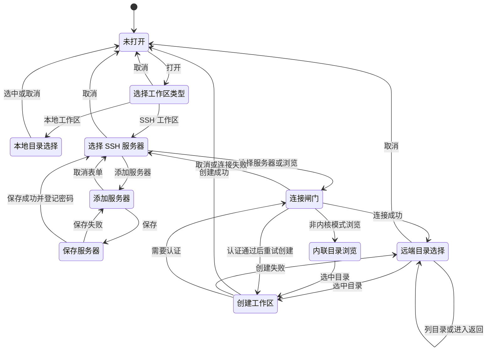

# 添加工作区流程状态机

本文描述从点击「添加工作区」到工作区创建成功/取消的完整流程，以及必须保持的不变量。实现位于 `src/client/directory-flow.tsx`；连接闸门（主机指纹、会话密码、连接失败提示）由 `src/client/connect-host.ts` 挂载。

## 状态

- `closed`：流程未打开（组件挂载但返回 `null`）。
- `menu`：选择「本地工作区 / SSH 工作区」。
- `local_native`：把内核自己的本地目录选择弹窗按引用渲染。
- `server_picker`：选择服务器；可与 `add_server` 叠加。
- `add_server`：填写新服务器；保存中为 `saving_host`。
- `gate`：点击服务器（或「浏览」）后先完成连接闸门，此时 busy/loading。
- `dir_browser`：内核远程目录弹窗（localhost 时是内联目录视图）。
- `inline_browser`：非内核模式下的内联目录列表。
- `creating`：正在把选中的远端目录登记为工作区。

## 状态转换

## 必须保持的不变量

1. **连接提示必须在最上层。** 主机指纹、会话密码、连接失败对话框统一由 `connect-host.ts` 的 `mountModal` 放进原生 `<dialog>` 顶层；否则会被服务器选择弹窗或内核目录弹窗盖住，表现为永远「加载中」或「卡死」。
2. **闸门先于目录弹窗。** 点击服务器后先 `ensureConnected`，连接通过才打开 `dir_browser`；避免在原生目录弹窗后面弹密码/指纹。
3. **密码只输入一次。** `secretStorage: none` 不落盘，但保存服务器后要把表单密码立即登记到引擎的会话内存表；首次连接直接复用。
4. **取消要能打断。** 关闭流程、切换分支时递增请求序号，迟到的列表/创建/闸门结果不得写回新状态。
5. **失败必须可恢复。** 闸门返回 `false` 后回到 `server_picker` 且行可用；创建失败回到目录弹窗并显示错误，不能停留在 busy。
6. **错误提示与承载弹窗同一层。** 目录弹窗内部错误走 `onError` toast；选择器错误走 `error` 区域；连接错误走顶层失败对话框。

## 创建时发生的事

选中远端目录后，`POST /api/dsh-hardssh/ws` 依次执行：

1. 校验 alias、远端根为绝对路径、主机存在。
2. 远端 `realpath` + `stat` 确认目录存在且是目录（不存在 → 400）。
3. `RemoteSandboxProvisioner.ensure(alias)`：探测平台、解析 `$HOME`、按需上传并验证 `landlock-run`；Landlock 可用性探测失败时验证已安装 bwrap（绝对路径、版本、namespace、只读拒绝及工作区写入围栏）。没有验证通过的后端则拒绝创建；部署或拒绝测试失败即停止。
4. 写入工作区台账，注册为原生 DSH 工作区；注册失败时补偿删除本次创建的记录。

第 2～4 步都会进入 SSH 操作日志（`workspace.create` 与 `sandbox.deploy`），失败时可在面板里展开查看原始命令与 stderr。
